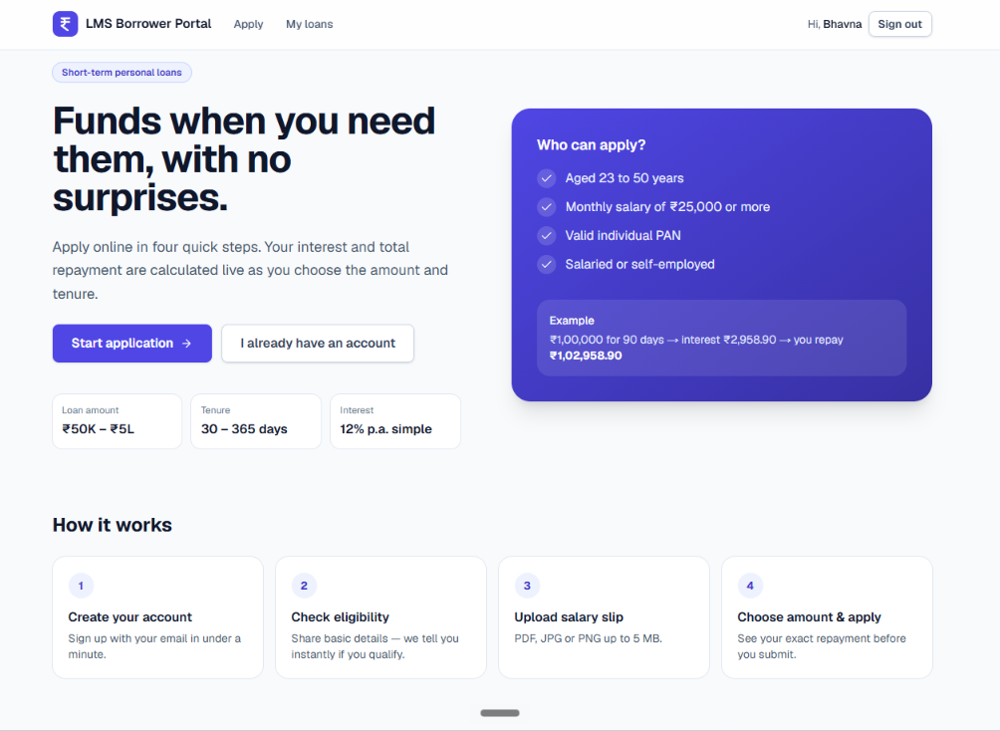
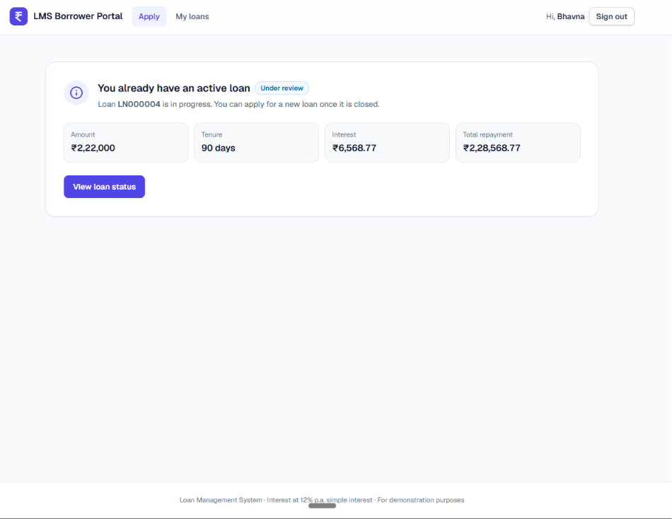
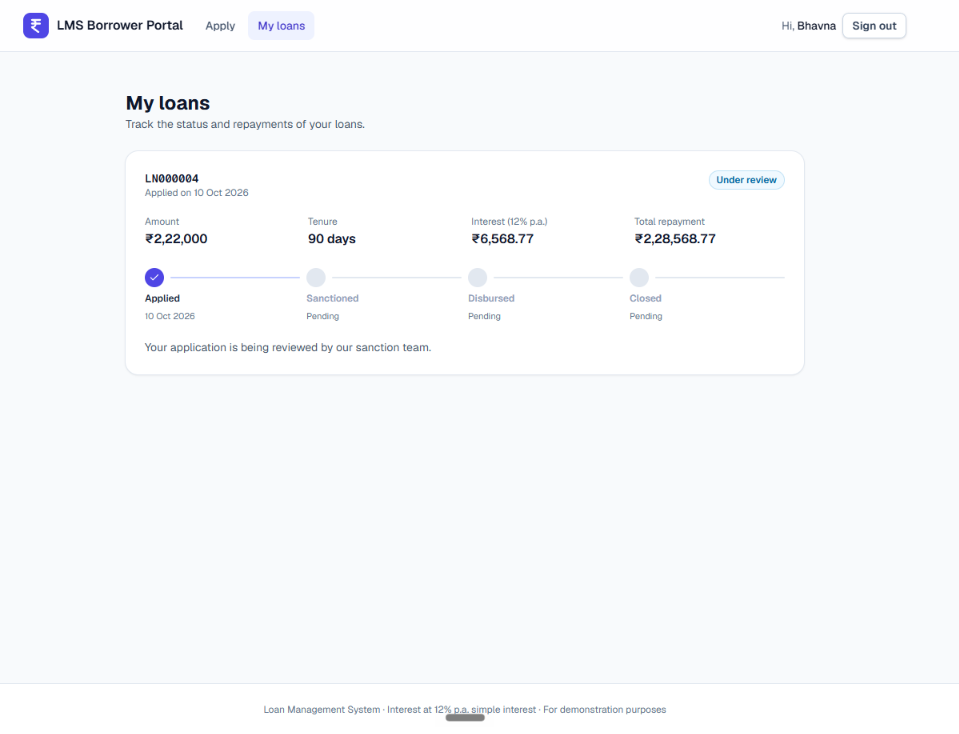
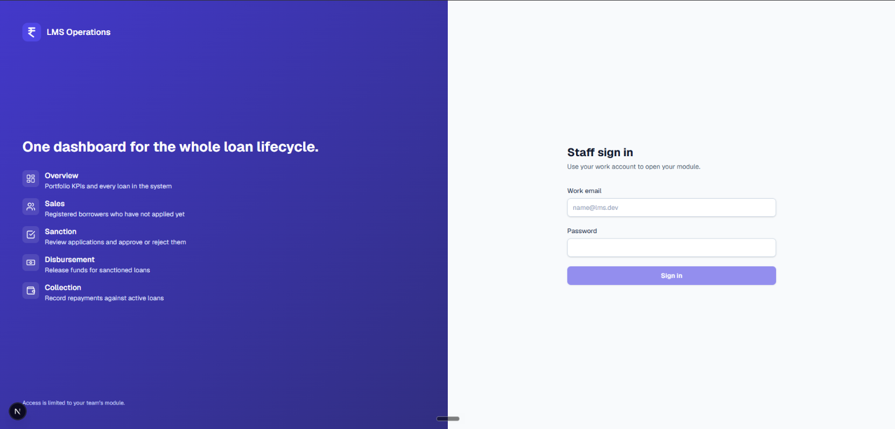
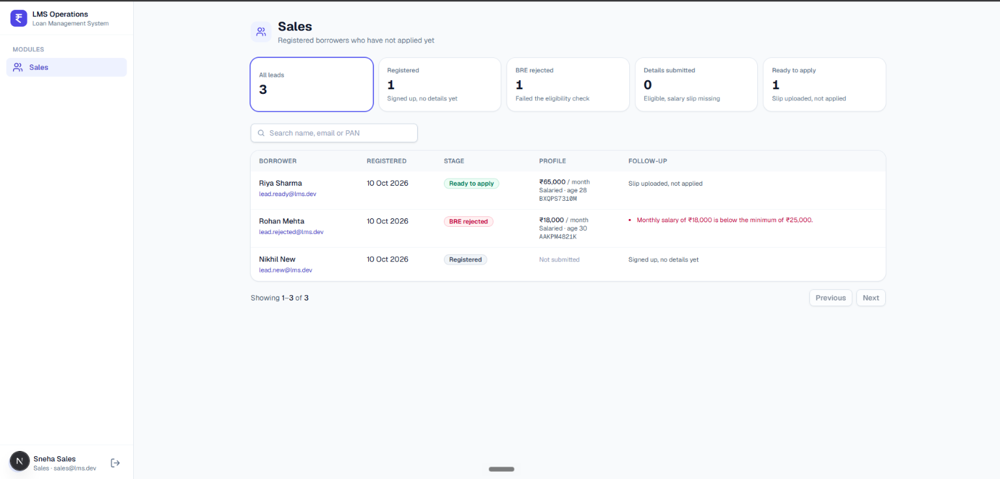
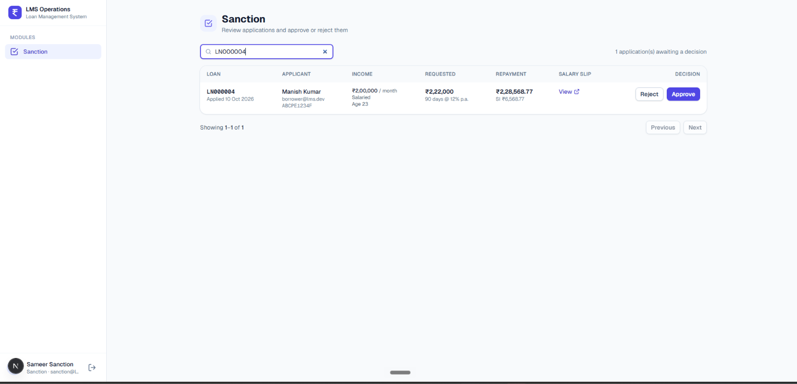
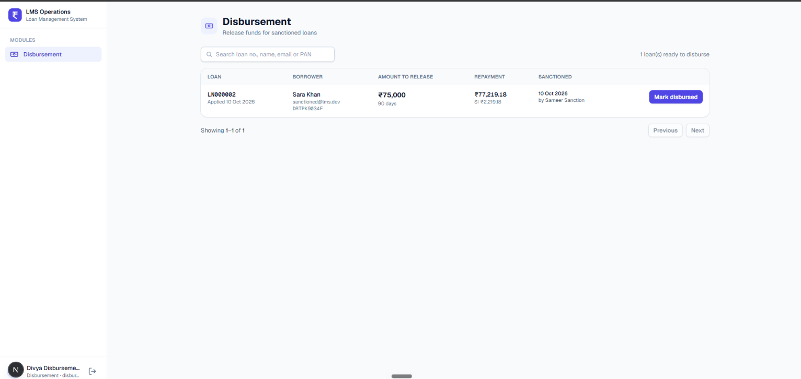
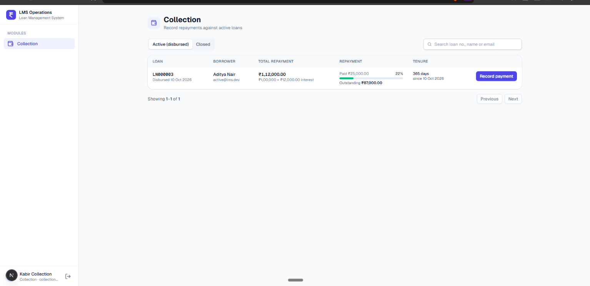
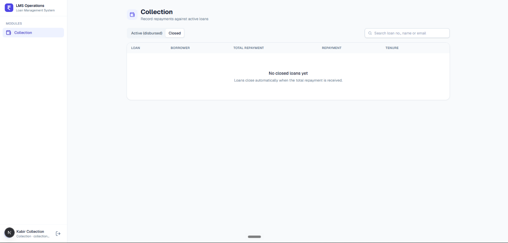

# Loan Management System (LMS)

A lending platform where borrowers apply for short-term loans and internal teams take each loan
through its lifecycle: **APPLIED → SANCTIONED → DISBURSED → CLOSED** (or **REJECTED**).

```
Borrower_Portal      (Next.js, :3000) ──┐
                                        ├── /api/* ──▶ backend (Express, :4000) ──▶ MongoDB Atlas
Operations_Dashboard (Next.js, :3001) ──┘   (rewrite,                                 (+ GridFS for salary slips)
                                             httpOnly cookies)
```

| Part | Folder | What it does |
| ---- | ------ | ------------ |
| API | [`backend/`](backend) | One Express + TypeScript API for both apps: auth, BRE, uploads, loan workflow, RBAC |
| Borrower Portal | [`Borrower_Portal/`](Borrower_Portal) | Sign up → personal details + eligibility → salary slip → loan sliders & apply → track |
| Operations Dashboard | [`Operations_Dashboard/`](Operations_Dashboard) | Sales, Sanction, Disbursement and Collection modules plus an Admin overview |
| Docs | [`docs/API`](docs/API), [`docs/prompt`](docs/prompt) | API reference; design and build prompt for each module |

**Stack:** Next.js 16 (App Router) · React 19 · TypeScript · Tailwind CSS 4 · Node.js · Express 5 ·
MongoDB Atlas (official `mongodb` driver, no Mongoose) · Zod · JWT · bcrypt · Multer → GridFS · Vitest

## Screenshots

**Borrower Portal**

| Home | Apply (active loan in progress) | My loans |
| ---- | ------------------------------- | -------- |
|  |  |  |

**Operations Dashboard**

| Staff login | Sales | Sanction |
| ----------- | ----- | -------- |
|  |  |  |
| **Disbursement** | **Collection — active** | **Collection — closed** |
|  |  |  |


### Borrower Portal

#### Home


#### Apply (active loan in progress)


#### My Loans


### Operations Dashboard

#### Staff Login


#### Sales


#### Sanction


#### Disbursement


#### Collection — Active


#### Collection — Closed

---

## Quick start

**Prerequisites:** Node.js ≥ 20 and a MongoDB Atlas cluster (the free M0 tier works).

1. **Atlas.** Create a database user and allow your IP under *Network Access*. Then copy the
   connection string from *Connect → Drivers*.
2. **Backend**
   ```bash
   cd backend
   cp .env.example .env          # set MONGODB_URI and JWT_SECRET (32+ chars)
   npm install
   npm run seed:demo             # role accounts + demo borrowers in every stage (or: npm run seed)
   npm run dev                   # http://localhost:4000/api/health
   ```
3. **Borrower Portal** (new terminal)
   ```bash
   cd Borrower_Portal
   cp .env.example .env.local
   npm install
   npm run dev                   # http://localhost:3000
   ```
4. **Operations Dashboard** (new terminal)
   ```bash
   cd Operations_Dashboard
   cp .env.example .env.local
   npm install
   npm run dev                   # http://localhost:3001
   ```

## Login credentials

Created by `npm run seed` in `backend/`. The seed is idempotent, and re-running it resets these passwords.

| Role | Email | Password | Where |
| ---- | ----- | -------- | ----- |
| Admin | `admin@lms.dev` | `Admin@123` | Dashboard — all modules |
| Sales | `sales@lms.dev` | `Sales@123` | Dashboard — Sales |
| Sanction | `sanction@lms.dev` | `Sanction@123` | Dashboard — Sanction |
| Disbursement | `disbursement@lms.dev` | `Disburse@123` | Dashboard — Disbursement |
| Collection | `collection@lms.dev` | `Collect@123` | Dashboard — Collection |
| Borrower | `borrower@lms.dev` | `Borrower@123` | Portal — clean account, walk the whole journey |

`npm run seed:demo` also adds `lead.new@`, `lead.rejected@`, `lead.ready@`, `applied@`,
`sanctioned@` and `active@lms.dev` (password `Borrower@123`), so every dashboard queue has data.
With `NEXT_PUBLIC_SHOW_DEMO_LOGINS=true`, the dashboard and portal login pages offer one-click demo sign-in.

## End-to-end walkthrough

1. **Portal:** sign in as `borrower@lms.dev`. Step 2 is *Personal details*.
   - **BRE fail:** PAN `ABCDE1234F`, date of birth making you 21, salary `20000`, *Unemployed*.
     The server rejects the submission and lists all four reasons.
   - **BRE pass:** PAN `ABCPE1234F`, age 30, salary `60000`, *Salaried*.
2. Upload a PDF/JPG/PNG salary slip (≤ 5 MB).
3. Move the sliders (₹50K–₹5L, 30–365 days). The panel recalculates the interest and total live → **Apply**.
4. **Dashboard:** `sanction@` → *Approve* (or *Reject* with a reason).
5. `disbursement@` → *Mark disbursed*.
6. `collection@` → *Record payment*: add a partial payment, then use *Pay full outstanding*. The loan
   **auto-closes**, and the borrower's *My loans* page shows the full timeline.

## Design decisions

**Data model** (see [docs/prompt/01-database.md](docs/prompt/01-database.md))

- `users` holds the role as a string enum. `borrower_profiles` is 1:1 with a user and keeps the details,
  the last BRE result and the slip metadata. `loans` snapshots the applicant and slip at apply time and
  stores the full `statusHistory`. `payments` has a unique `utr`. `counters` generates loan numbers
  (`LN000001`).
- Database-level guarantees: a unique email, a unique UTR, one eligible profile per PAN, and **one
  active loan per borrower** (a partial unique index on `borrowerId`, so even a double-click on
  *Apply* cannot create two).

**Loan state machine.** `LOAN_TRANSITIONS` maps `from → to → allowed roles`. Every status change goes
through one `transitionLoan()` function, whose update filters on the expected current status. That
makes each transition atomic: if two executives act on the same loan, one wins and the other gets
`409`.

**BRE: client *and* server.** The server is authoritative. It runs the BRE when details are submitted
and again at apply time, because age can change in between and clients can be bypassed. The portal
mirrors the rules as a live checklist for instant feedback. The PAN rule is
`^[A-Z]{3}P[A-Z][0-9]{4}[A-Z]$`: the 4th character is the holder type, and personal loans need `P`
(individual), so a company PAN such as `ABCCE1234F` is rejected. Failed checks are stored, so Sales
can follow up.

**Money.** SI = (P × R × T) / (365 × 100), where T is in days. It is computed on the server in
integer paise and rounded half-up once. Outstanding = total − paid is derived, never stored twice. A
payment must be > 0, have at most 2 decimals, not exceed the outstanding balance, and fall between
the disbursement date and today. Recording a payment and closing the loan happen in **one MongoDB
transaction**.

**RBAC in three layers.**
1. `proxy.ts` in each Next app: an optimistic, cookie-only route guard. It redirects to `/login` or
   `/forbidden`.
2. UI: the sidebar shows only allowed modules, and `<RequireRole>` re-checks the role from
   `/auth/staff/me`.
3. API (authoritative): `authenticate(portal)` returns **401** for a missing, invalid or expired session
   or the wrong audience. `authorize(...roles)` returns **403** for a valid session with the wrong role.
   Borrower data is always scoped to the signed-in borrower, and another borrower's loan id gives 404.

**Sessions.** The JWT is stored in an **httpOnly, SameSite=Lax cookie**, so page scripts can't read it.
Each Next app proxies `/api/*` to the backend, which keeps cookies first-party with no CORS. Borrower
and staff use different cookie names and JWT audiences, so both apps work side by side in one
browser. `Authorization: Bearer` is also accepted for API clients.

**Uploads.** Multer accepts the file in memory (5 MB limit) after checking the extension and MIME
type. The service then verifies the real format from its magic bytes, so a renamed `.exe` gets 415.
Files go to **GridFS** in Atlas, so nothing depends on local disk.

## Project structure

```
backend/src
├── config/        env validation (zod)            ├── services/     business logic (BRE, workflow, modules)
├── constants/     roles, loan rules, BRE, upload  ├── controllers/  thin HTTP handlers
├── db/            client, collections, indexes,   ├── routes/       one router per module + RBAC chain
│                  GridFS, transactions            ├── utils/        errors, JWT, money, dates, mappers
├── interfaces/    documents, DTOs, request types  ├── scripts/      seed.ts
├── validations/   zod schemas per module          └── app.ts / server.ts
└── middlewares/   authenticate/authorize, validate, upload, errors, rate limit
backend/tests      BRE + loan-math unit tests

Borrower_Portal/src      app/ (/, /login, /register, /apply, /my-loans) · components/apply · components/loans · lib · proxy.ts
Operations_Dashboard/src app/(dashboard)/{overview,sales,sanction,disbursement,collection} · components/modules · lib/rbac.ts · proxy.ts
```

## Scripts

| Where | Command | Purpose |
| ----- | ------- | ------- |
| backend | `npm run dev` / `build` / `start` | API in watch mode / compile / run compiled |
| backend | `npm run seed` / `seed:demo` | role accounts / plus demo borrowers |
| backend | `npm test` | unit tests (BRE boundaries, PAN, SI rounding, dates) |
| all apps | `npm run typecheck` | `tsc --noEmit` |
| Next apps | `npm run dev` / `build` / `start` / `lint` | Next.js |

## API

See **[docs/API](docs/API/README.md)** for every endpoint with its access, request, response and
status codes.

## Troubleshooting

| Symptom | Fix |
| ------- | --- |
| `querySrv ECONNREFUSED _mongodb._tcp…` on start/seed | Node can't use your OS DNS server (common on Windows with an IPv6 router DNS). Add `DNS_SERVERS=8.8.8.8,1.1.1.1` to `backend/.env`. |
| `MongoServerSelectionError` / timeout | Add your IP (or `0.0.0.0/0` for testing) under Atlas → *Network Access*. |
| `bad auth : authentication failed` | Check the database user/password in `MONGODB_URI`, and URL-encode special characters in the password. |
| API starts but the app shows "Could not reach the server" | Start the backend first. If it's not on `localhost:4000`, set `BACKEND_URL` in the app's `.env.local`. |

## Deployment notes

- Backend: set `NODE_ENV=production` and `COOKIE_SECURE=true` (HTTPS), and use a strong `JWT_SECRET`.
- Next apps: set `BACKEND_URL` **before** `npm run build`, because the `/api` rewrite is baked in at
  build time.
